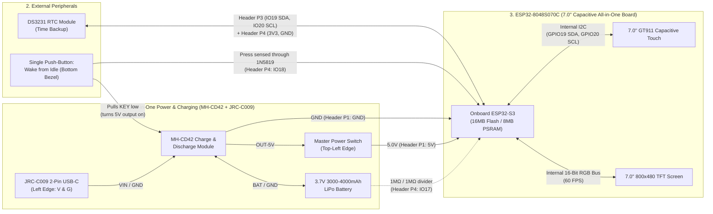

# Selected Hardware, Charging Components & Circuit Diagrams (7.0" `ESP32-8048S070C` + `MH-CD42` All-in-One Power Build)

This document locks in the streamlined hardware architecture combining:
1. **7.0-inch (800×480) Capacitive Touch + ESP32-S3 All-in-One Board (`ESP32-8048S070C` / `JC8048W570C`)**
2. **`MH-CD42` All-in-One 5V 2A Charge & Discharge Module** (replaces the separate charger, battery protection, load-sharing circuit, 5V boost converter, and smoothing capacitors on a single tiny board)
3. **`JRC-C009` 2-Pin Panel-Mount USB-C Female Socket** (mounts flush into the left edge of the 3D-printed case)
4. **Option B Capacitive Stylus**, **Master Power Slide Switch**, **Bottom-Bezel Wake Button** (diode-isolated so the ESP32-S3 can safely sense presses), **Battery Level Divider** (for an on-screen battery %), and **DS3231 Real-Time Clock (RTC)**.

> [!NOTE]
> **Revision (2026-11-04):** The wake button no longer connects the `MH-CD42` `KEY` pad straight to `GPIO 18`. The `KEY` pad can sit at up to 4.2V, which is above the ESP32-S3's 3.3V pin limit, so a `1N5819` diode now separates them (Section 5B). A battery level divider on `GPIO 17` has also been added (Section 5C).

---

## 1. Core Component Specifications

### A. Display + Brain: `ESP32-8048S070C` / `JC8048W570C`
- **Integrated 60 FPS Display Bus:** The onboard **ESP32-S3-WROOM-1 (N16R8: 16MB Flash, 8MB Octal PSRAM)** drives the **7.0-inch 800×480 TFT panel** over a **16-bit Parallel RGB interface**, delivering smooth 60 FPS animations, task drag-and-drop, and zero-latency handwriting.
- **Capacitive Touch (`GT911`):** Factory-laminated 7.0-inch glass capacitive touch panel (`C` suffix) running over I2C (`GPIO 19` SDA, `GPIO 20` SCL).
- **Exact Search Terms:** `ESP32-8048S070C` or `JC8048W570C` *(Ensure you select the **`C` (Capacitive Touch)** model)*.

### B. All-in-One Charging & 5V Boost Module: `MH-CD42` + `JRC-C009` (2-Pin USB-C)
- **`MH-CD42` 5V 2A Charge & Discharge Module:** Combines the **LiPo battery charger (4.2V cutoff)**, **overcharge/over-discharge/short-circuit protection**, **pass-through load sharing (charge while using)**, and **3.7V-to-5.0V (2A) DC-DC Boost Converter** (`1R0` inductor + filtering capacitors) on one `25mm × 16mm` PCB.
- **`JRC-C009` 2-Pin Panel-Mount USB-C Socket:** Get the **2-Pin version** (`V` and `G` solder pads). Because this external port is used exclusively for charging (`VIN` and `GND` on the `MH-CD42`), the 2-pin version gives you large, easy-to-solder pads and a flat screw/glue faceplate that mounts flush into the left wall of your 3D-printed case.

---

## 2. Specific List of All Required Components (Bill of Materials)

| # | Item | Specific Part / Model | Specifications & Role | Est. Price |
| :- | :--- | :--- | :--- | :--- |
| **1** | **7.0" Display + Brain** | **`ESP32-8048S070C` (or `JC8048W570C`)** | 7.0" 800×480 RGB TFT + `GT911` Capacitive Touch + **ESP32-S3 (16MB Flash, 8MB PSRAM, BLE 5.0)**. | **£21.00** |
| **2** | **All-in-One Charger & 5V Booster** | **`MH-CD42` 5V 2A Charge & Discharge Module** | Handles LiPo charging, battery protection, simultaneous charge-and-discharge, and regulated `OUT-5V` boosting. | **£1.20** |
| **3** | **USB-C Charging Port** | **`JRC-C009` 2-Pin Panel-Mount USB-C Female Socket** | Flush-mount USB-C port with `V` (`+5V`) and `G` (`GND`) solder pads wired to `VIN` and `GND` on the `MH-CD42`. | **£0.60** |
| **4** | **LiPo Battery** | **3.7V 3000mAh–4000mAh LiPo Pouch Cell (e.g., `606090`)** with built-in PCM protection board | Flat pouch cell fits cleanly behind the 7.0" screen. Powers the tablet for ~5–7 hours of active screen-on use. | **£5.50** |
| **5** | **Master Power Switch** | **SPDT Slide Switch (`SS12D00G4`, ≥1A rating)** | Mounted at the top-left edge. Placed on the `OUT-5V` line so **you can still charge the battery via USB-C while the switch is OFF**. | **£0.50** |
| **6** | **Real-Time Clock (RTC)** | **DS3231 RTC Module** (ZS-042 or Mini, with `LIR2032` / `CR2032` backup coin cell) | Keeps exact calendar date/time when the tablet is powered off so event-linked tasks auto-complete on schedule ([idea.md](file:///home/diego/Personal-Projects/task-calendar/idea.md#L81)). | **£1.50** |
| **7** | **Paper Texture Film** | **Matte PET "Paperlike" Tablet Screen Protector** | Cut to fit the 7.0" glass screen (`165mm × 100mm`) for paper friction with the stylus. | **£1.50** |
| **8** | **Stylus Tips (Option B)** | **Universal Replacement Capacitive Precision Disc Tips** (or Conductive Mesh Fiber Tips) | Press-fitted into your 3D-printed stylus barrel and connected to an internal copper-foil / bare-wire finger grip path. | **£1.50** |
| **9** | **Wake-Button Isolation Diode** | **1× `1N5819` Schottky Diode** (through-hole) | Lets the ESP32-S3 sense the wake button **without** exposing `GPIO 18` to the `KEY` pad voltage. See Section 5B. | **£0.50** *(pack)* |
| **10** | **Battery Level Divider** | **2× `1MΩ` 1% Resistors** + **1× `100nF` Ceramic Capacitor** | Halves the battery voltage (`3.0–4.2V` → `1.5–2.1V`) so `GPIO 17` can measure it for the on-screen battery %. The `MH-CD42` itself only has LEDs. See Section 5C. | **£0.50** *(packs)* |
| **11** | **Free Stock Items** | **3D Filament, Wires, Solder, & 1× Tactile Push-Button** | Used for the 3D-printed Case, Stylus, internal wiring, and the **Bottom-Bezel Wake Button**. | **£0.00** |

> **Total Estimated Project Cost:** **~£34.30**

---

## 3. Circuit Diagram 1: System Architecture & Power Flow Overview



---

## 4. Circuit Diagram 2: `JRC-C009` USB-C + `MH-CD42` + Battery + Master Switch Schematic

With the **`MH-CD42`** and **`JRC-C009` 2-Pin USB-C Socket**, the entire power and charging circuit simplifies down to direct wire-to-pad connections (no perfboard required!):

```text
===============================================================================================
             SIMPLIFIED POWER & CHARGING SCHEMATIC (JRC-C009 + MH-CD42 + LIPO)
===============================================================================================

   +------------------------+          +------------------------------------+
   |   JRC-C009 2-Pin       |          |      MH-CD42 CHARGE & DISCHARGE    |
   |  Panel-Mount USB-C     |          |        5V 2A BOOST MODULE          |
   | (Mounted on Left Edge) |          |                                    |
   |                        |          |              [KEY] Pad             |
   |                    [V] |--------->| [VIN]          |                   |
   |                        |   Red    |                +-------------------+---> To Wake Button circuit
   |                    [G] |--------->| [GND]                              |     (Node N, Section 5B)
   +------------------------+  Black   |                                    |
                                       | [GND] <----[Black Wire (-) ]-------+---> From 3.7V LiPo Battery (-)
                                       | [BAT] <----[Red Wire   (+) ]-------+---> From 3.7V LiPo Battery (+)
                                       |                                    |     (BAT also feeds the
                                       |                                    |      Battery Divider, 5C)
                                       | [GND] -----------------------------+---> Common System GND
                                       |                                    |     (To ESP32-8048S070C
                                       | [OUT-5V]                           |      Header P1: GND)
                                       +----+-------------------------------+
                                            |
                                            |  +5.0V Regulated Output
                                            o
                                             \   Master Power Slide Switch (SS12D00G4)
                                              \  (Mounted on Top-Left Edge of Case)
                                            o
                                            |
                                            v
                                  +5.0V SYSTEM RAIL
                         (To ESP32-8048S070C Header P1: 5V)
===============================================================================================
```

### Key Power & Charging Features of This Wiring:
1. **Charge While Switched OFF:** Because the **Master Power Slide Switch** is placed on the `OUT-5V` output wire (after the `MH-CD42`), you can plug a USB-C cable into the `JRC-C009` port and charge the LiPo battery even when the top-left Master Switch is switched completely OFF.
2. **Simultaneous Charge & Use:** Because the `MH-CD42` supports pass-through charging (`Charge & DisCharge`), you can also use the tablet while plugged into USB-C.
3. **Charging Cables:** A 2-pin USB-C socket always works with a **USB-A to USB-C cable**. **USB-C to USB-C** chargers only supply power if the socket's small PCB has two **5.1kΩ "CC" resistors**. Many `JRC-C009` listings include them (look for "5.1K resistor" or "supports C-to-C" in the listing). Check before buying, or test with a C-to-C cable when it arrives.
4. **Battery Level Tap:** The battery level divider (Section 5C) connects to the **`BAT`** pad (the battery side, before the switch), so it always measures the real battery voltage.

---

## 5. Circuit Diagram 3: Expansion Headers, Wake Button & Battery Level

Because the 7.0" screen and `GT911` capacitive touch controller are already wired internally on the `ESP32-8048S070C` PCB, **you only need to connect the expansion headers (`P1`, `P3`, `P4`) on the back of the display** to your `MH-CD42`, `DS3231` RTC, wake button, and battery divider.

> [!WARNING]
> **Go by the labels printed on your board, not the pin order shown here.** The order of the pins on the `P1`/`P3`/`P4` headers differs between board revisions, so match each wire to the silkscreen label (`5V`, `GND`, `IO17`, `IO18`, `IO19`, `IO20`, `3V3`). On some revisions `IO17`/`IO18` are also routed to the onboard speaker amplifier or the touch interrupt. During bench test A2 ([implementation_plan.md](file:///home/diego/Personal-Projects/task-calendar/implementation_plan.md)), confirm they are free on your board. If they aren't, and you aren't using the microSD slot, use `IO11`/`IO12`/`IO13` on header `P2` instead. Those pins can also read voltages and wake the chip.

### 5A. Expansion Header Connections (Overview)

- **Shared I2C Bus (`IO19` = SDA, `IO20` = SCL on Header `P3`):** Shared between the onboard `GT911` Capacitive Touch (`0x5D`/`0x14`) and your external **DS3231 RTC Module** (`0x68`).

```text
===============================================================================================
        BACK OF ESP32-8048S070C / JC8048W570C — EXPANSION HEADER CONNECTIONS (OVERVIEW)
===============================================================================================

                                   +---------------------------------------------------+
                                   |     ESP32-8048S070C / JC8048W570C (REAR PCB)      |
                                   |   (Onboard ESP32-S3 N16R8 + 7.0" RGB + GT911)     |
                                   |                                                   |
                                   |  HEADER P1 (Power In)                             |
   From Master Switch [+5.0V] ---->|    [5V  ]                                         |
   From MH-CD42 [GND] ------------>|    [GND ]                                         |
                                   |    [TX  ] [RX ]   (not used)                      |
                                   |                                                   |
                                   |  HEADER P3 (I2C)                                  |
   DS3231 [SCL] <----------------->|    [IO20]  I2C SCL (shared with onboard GT911)    |
   DS3231 [SDA] <----------------->|    [IO19]  I2C SDA (shared with onboard GT911)    |
                                   |                                                   |
                                   |  HEADER P4 (IO + 3.3V)                            |
   Wake sense diode (5B) --------->|    [IO18]  input, internal pull-up                |
   Battery divider (5C) ---------->|    [IO17]  ADC2_CH6                               |
   DS3231 [VCC] <------------------|    [3V3 ]                                         |
   DS3231 GND, button GND,         |                                                   |
   divider GND, 100nF GND <--------|    [GND ]                                         |
                                   +---------------------------------------------------+
===============================================================================================
```

### 5B. Wake Button Circuit (Diode-Isolated)

The single bottom-bezel button does two jobs: it **pulls the `MH-CD42` `KEY` pad low** (which turns the 5V output back on and wakes the tablet), and it lets the **ESP32-S3 see presses** on `IO18` while it's running. The `1N5819` diode stops the `KEY` pad's voltage (up to ~4.2V) from ever reaching `IO18` (3.3V maximum).

```text
===============================================================================================
     WAKE BUTTON CIRCUIT — WAKES THE MH-CD42 + LETS THE ESP32-S3 SAFELY SEE BUTTON PRESSES
===============================================================================================

   MH-CD42 [KEY] pad -----------------------------+
                                                  |
                                              Node "N"
                                                  |
   ESP32 [IO18] (Header P4) ------->|-------------+
   (input, internal pull-up      1N5819           |
    to 3.3V)                 anode -> cathode     o
                            (stripe faces N)      |   <-- Wake push-button
                                                  o       (bottom-centre bezel)
                                                  |
                                                 GND  (Header P4 GND or MH-CD42 GND)
===============================================================================================
```

| Situation | Node N | Diode | Result |
| :--- | :--- | :--- | :--- |
| Tablet **off** (MH-CD42 output off), button pressed | Pulled to 0V | — (ESP32 unpowered) | `KEY` goes low → `MH-CD42` turns its 5V output on → tablet boots |
| Tablet **on**, button released | Sits at the `KEY` voltage (up to ~4.2V) | **Blocks** | `IO18` is held at **3.3V (HIGH)** by its pull-up. The higher `KEY` voltage never reaches the pin |
| Tablet **on**, button pressed | Pulled to 0V | Conducts | `IO18` reads **LOW (~0.3V)** → firmware sees the press |

**Important notes:**
- **Diode direction:** the **stripe (cathode) faces node N / the `KEY` pad**. If it's fitted the wrong way round, the button still wakes the tablet, but the ESP32 never sees presses.
- **Double-press = power off:** the `MH-CD42` switches its 5V output off if `KEY` is pressed twice within about a second. The firmware sees the **first** press on `IO18` and **saves all data immediately**, so a double-press can't lose edits.
- **Read-only:** the ESP32 can *read* the button through the diode, but it can't "press" `KEY` itself. Nothing in the design needs that. If bench test A2.6 shows that the `MH-CD42` doesn't switch itself off when the tablet idles, an optional NPN transistor lets the firmware press `KEY` (e.g. a double-press to force power off): `BC547`/`2N3904`, collector to node N, emitter to GND, base through a `10kΩ` resistor from a spare GPIO.
- **Check during bench test A2.6:** measure the `KEY` pad's resting voltage. If it's **below ~2.8V**, `IO18` might not read a clean HIGH when released. In that case, switch to the transistor version above.

### 5C. Battery Level Divider

```text
===============================================================================================
              BATTERY LEVEL DIVIDER — LETS THE UI SHOW THE BATTERY PERCENTAGE
===============================================================================================

   MH-CD42 [BAT] pad (= LiPo +, 3.0V – 4.2V)
          |
       [ 1MΩ ]
          |
          +------------------------+---------> ESP32 [IO17] (Header P4)   reads 1.5V – 2.1V
          |                        |
       [ 1MΩ ]                 [ 100nF ]
          |                        |
         GND                      GND
===============================================================================================
```

- **Firmware:** read `IO17` with 12dB attenuation, average 16 samples, multiply by 2 to get the battery voltage, then convert to % using a LiPo discharge curve (4.20V = 100%, ~3.70V ≈ 40%, ~3.40V ≈ 5%).
- **While charging,** the charger pushes the battery voltage up, so the % reads high until you unplug.
- **Tiny drain:** the divider draws ~2µA all the time (about 17mAh per year, negligible). It's also safe while the ESP32 is unpowered, because the 1MΩ resistor limits any current into the pin to ~2µA.
- **Why the 100nF capacitor:** with such high-value resistors, the capacitor gives the ADC a steady charge to sample from, so the readings are accurate.
- **Use 1% resistors** so both halves match.

### 5D. Complete Pin Reference Tables

#### A. External Connections (What You Wire by Hand)
| From | To | Purpose |
| :--- | :--- | :--- |
| **`JRC-C009` `V`** | `MH-CD42` `VIN` | +5V USB-C charging input |
| **`JRC-C009` `G`** | `MH-CD42` `GND` | USB-C charging ground |
| **LiPo `+` (red)** | `MH-CD42` `BAT` | Battery positive (charge & discharge) |
| **LiPo `−` (black)** | `MH-CD42` `GND` | Battery negative |
| **`MH-CD42` `OUT-5V`** | Master switch → Header `P1` `5V` | Regulated +5.0V supply to display & ESP32-S3 |
| **`MH-CD42` `GND`** | Header `P1` `GND` | Main system ground |
| **`MH-CD42` `KEY`** | Node N (wake button + `1N5819` cathode) | Turns the 5V output on when the button is pressed |
| **Wake button (other leg)** | `GND` | |
| **`1N5819` anode** | Header `P4` `IO18` | Button press sensing (input, pull-up, active LOW) |
| **`MH-CD42` `BAT`** | Top `1MΩ` of divider | Battery voltage tap |
| **Divider midpoint + `100nF`** | Header `P4` `IO17` | Battery level (ADC) |
| **Bottom `1MΩ` + `100nF`** | `GND` | Divider ground |
| **DS3231 `SCL`** | Header `P3` `IO20` | I2C clock (shared with internal GT911) |
| **DS3231 `SDA`** | Header `P3` `IO19` | I2C data (shared with internal GT911) |
| **DS3231 `VCC`** | Header `P4` `3V3` | 3.3V power for the RTC |
| **DS3231 `GND`** | Header `P4` `GND` | RTC ground |

#### B. Firmware Pin Summary (Internal Pre-Wired + External)
| Peripheral | ESP32-S3 GPIOs | Notes for Software Setup |
| :--- | :--- | :--- |
| **Backlight PWM Control** | **`GPIO 2`** | Use `ledcWrite` / PWM on `GPIO 2` for the Settings brightness slider & idle screen-off. |
| **Capacitive Touch (`GT911`)** | `SDA = GPIO 19`, `SCL = GPIO 20`, `RST = GPIO 38` | Poll `GT911` at I2C address `0x5D` or `0x14`. |
| **DS3231 RTC** | Same I2C bus (`GPIO 19` / `GPIO 20`) | I2C address `0x68`. |
| **Wake Button Sense** | **`GPIO 18`** | `INPUT_PULLUP`, active LOW, debounce ~30ms. On the first press, save all data immediately (see 5B). |
| **Battery Level** | **`GPIO 17`** | ADC2_CH6, 12dB attenuation, ×2 scaling (see 5C). |
| **7.0" 16-Bit RGB Display** | `DE = 41`, `VSYNC = 40`, `HSYNC = 39`, `PCLK = 42`<br>`R0..R4 = 14, 21, 47, 48, 45`<br>`G0..G5 = 9, 46, 3, 8, 16, 1`<br>`B0..B4 = 15, 7, 6, 5, 4` | Driven at 60 FPS using `ESP32_Display_Panel` / `Arduino_GFX` + `LVGL`. |

---

## 6. Diagram 4: Physical Enclosure & Component Placement (From [device_sketch.jpeg](file:///home/diego/Personal-Projects/task-calendar/drawings/device/device_sketch.jpeg))

Based on [device_sketch.jpeg](file:///home/diego/Personal-Projects/task-calendar/drawings/device/device_sketch.jpeg), the tablet operates in **Landscape Orientation (`800×480`)** with the following physical hardware perimeter and internal routing:

```text
===============================================================================================
             PHYSICAL DEVICE LAYOUT & INTERNAL COMPONENT ROUTING (FRONT VIEW)
===============================================================================================

                   [Master Power Slide Switch] (Top-Left Edge: Cuts OUT-5V to fully turn off)
                        |
                     +-[===]-------------------------------------------------------+
                     |  +-------------------------------------------------------+  |
   [JRC-C009] ------>|==|  M   T   W   T   F   S   S  |       March 1st         |  |
   (2-Pin USB-C      |  |  1 | 2 | 3 | 4 | 5 | 6 | 7  | 14:00 ----------------- |  |
    mounted flush    |  |  8 | 9 |10 |11 |12 |13 |14  | 15:00 +---------------+ |  |---+
    on left edge,    |  | 15 |16 |17 |18 |19 |20 |21  |       |15:00-16:00 Mtg| |  |   | 3D-Printed
    wired to MH-CD42)|  | 22 |23 |24 |25 |26 |27 |28  | 16:00 +---------------+ |  |   | Stylus Holder
                     |  | 29 |30 |31 |   |   |   |    | 17:00 ----------------- |  |---+ (Right Edge)
                     |  |                             | 18:00 ----------------- |  |
                     |  +-----------------------------+-------------------------+  |
                     |  |  [v] Tasks   |    [Cal] Calendar    |   [*] Settings  |  | <-- On-Screen Stylus
                     |  +-------------------------------------------------------+  |     Page Selector Bar
                     |                     (===============)                       |
                     +-------------------------------------------------------------+
                                                   ^
                                   [Single Push-Button: Wake from Idle]
              (Mounted on Bottom Center Bezel -> MH-CD42 KEY, sensed by IO18 via 1N5819)
===============================================================================================
```

---

## 7. Diagram 5: Option B Capacitive Stylus ("Electronic Pencil") Internal Circuit

Because a capacitive screen relies on your hand's natural capacitance (~100pF) reaching the stylus tip, a standard non-conductive PLA barrel would isolate your fingers from the tip. Here is how to build the **3D-Printed Option B Stylus** so it works reliably every time on the 7.0" screen:

```text
===============================================================================================
                3D-PRINTED CAPACITIVE STYLUS (OPTION B) CROSS-SECTION
===============================================================================================

      3D-Printed PLA/PETG Upper Barrel                 Conductive Finger Grip Band
   +-------------------------------------+-----------------------+-----------+
   |                                     |  Copper Foil Tape or  |           |  /--- Precision Clear
   |         Hollow Internal Channel     |  Aluminum Tape Wrap   |  Press-Fit| /     Disc Tip or
   |   ==================================+=======================+===========+|======O  Conductive
   |         Bare Copper Wire (Free)     |  (Contacts User's     |  Metal M5 || \     Mesh Tip
   |         running to Tip Ferrule      |   Fingers Naturally)  |  Insert   |  \--- (Option B)
   +-------------------------------------+-----------------------+-----------+
                                                                              ^
                                                                              |
                                                       6mm Conductive Pad couples hand capacitance
                                                       through the Paperlike Matte Film to the 7.0" screen
===============================================================================================
```

1. **Print the barrel** in two halves or with a 2mm center hole down the grip section.
2. **Thread a strip of bare copper wire** (from your free wire stock) from the metal base of the **Option B replacement capacitive tip** out to the grip zone where your fingers hold the pencil.
3. **Wrap a neat band of conductive copper/aluminium tape** (or bare wire coil) around the finger grip zone so your skin touches it while writing.
