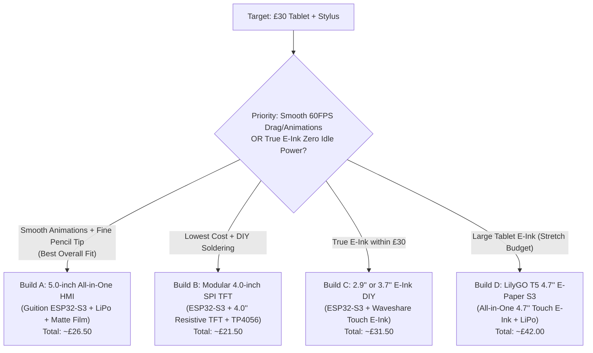

# Hardware Component Research & Options (~£30 Budget)

Based on the requirements in [idea.md](file:///home/diego/Personal-Projects/task-calendar/idea.md#L11-L55), the device needs to be a **portable, battery-powered tablet** (~£30 budget) with **Bluetooth**, **stylus/handwriting input**, **paper-like texture**, **low power consumption**, and **smooth animations/drag-and-drop UI**.

> [!IMPORTANT]
> **The Central Hardware Trade-Off: E-Ink vs. Smooth Animations & £30 Budget**
> In [idea.md](file:///home/diego/Personal-Projects/task-calendar/idea.md#L15-L20), the Display section suggests **E-Ink** for zero idle power and paper feel, while the Software section ([idea.md](file:///home/diego/Personal-Projects/task-calendar/idea.md#L60-L70)) requires **smooth, fluid animations**, **drag-and-drop task reordering**, and **live handwriting input**.
> - **E-Ink panels** have slow refresh rates (~300–500ms for partial refresh, 1.5–3s for full refresh), making smooth drag-and-drop and fluid animations very difficult (ghosting/stuttering), and touch-enabled e-ink panels over 3 inches cost **£25–£45 alone**.
> - **TFT/IPS LCD panels** combined with a **matte "Paperlike" screen protector film (~£2)** deliver 60 FPS smooth animations, low-latency stylus drawing, and a realistic paper-friction texture well inside the £30 budget—at the cost of needing sleep modes to save battery when idle.

---

## 1. Display Options

The display is the largest cost driver and defines how the stylus and UI behave. Because the Calendar page uses a **split view (Month on left + Day Timeline on right)** ([idea.md](file:///home/diego/Personal-Projects/task-calendar/idea.md#L74)), a screen size of **at least 3.5" to 5.0" (480×320 or 800×480)** is strongly recommended.

| Display Technology | Sizes & Resolution | Touch Type | Pros | Cons | Approx. Price (UK / AliExpress) |
| :--- | :--- | :--- | :--- | :--- | :--- |
| **1. Resistive TFT LCD** *(e.g., ILI9488 / ST7796)* | 3.5" – 4.0" (480×320) | **Resistive (XPT2046)** | Works with a **100% 3D-printed PLA stylus** (pressure-based, fine pinpoint tip); very cheap; easy SPI wiring. | Slightly dimmer top layer; single-touch only; requires backlight when active. | **£6 – £11** |
| **2. Capacitive IPS LCD** *(Separate or Integrated RGB)* | 4.0" – 5.0" (480×320 or 800×480) | **Capacitive (GT911 / FT6236)** | Bright, wide viewing angles; light touch (no pressure needed); multi-touch support. | Requires a **conductive stylus tip** ( ~6mm rubber/mesh/disc or conductive filament); uses more pins unless integrated. | **£10 – £18** |
| **3. Touch E-Paper (E-Ink)** *(Waveshare 2.9" / 3.7" / 4.2")* | 2.9" (296×128) to 4.2" (400×300) | **Capacitive** (mostly on 2.9") or custom overlay | Zero power when static; true paper look; readable in bright sunlight. | **Expensive**; 2.9" is very cramped for split-screen calendar; slow refresh breaks smooth drag-and-drop & animations. | **£22 – £35** (Panel only) |
| **4. Reflective / Monochrome LCD** *(ST7565 / Sharp Memory LCD)* | 2.7" – 4.4" (128×64 to 400×240) | **None native** (requires separate touch panel overlay) | Fast refresh (30–60Hz) + ultra-low power like e-ink. | Does not come with touch built-in; Sharp panels are expensive (£25–£40). | **£8 – £38** |

> [!TIP]
> **How to get the "Paper Texture" on any LCD for £2:**
> Buy a cheap oversized **matte PET "Paperlike" iPad screen protector (£1.50–£3)** and cut it to the exact size of your 3.5"–5" screen with scissors. It removes glare and adds physical tooth/friction so a 3D-printed stylus feels like writing on paper.

---

## 2. Microcontroller ("The Brain") Options

The brain needs **Bluetooth Low Energy (BLE)** to sync with the iPhone 12 (iOS restricts classic Bluetooth SPP to MFi-certified hardware, so **BLE GATT** is mandatory for iOS communication without paid Apple hardware licensing), enough **RAM/Flash** for a smooth UI (e.g., LVGL graphics library) + on-device handwriting recognition, and **low deep-sleep current**.

| Microcontroller | CPU & Clock | RAM / Flash | Bluetooth | Why Choose It / Trade-offs | Approx. Price |
| :--- | :--- | :--- | :--- | :--- | :--- |
| **ESP32-S3 (N16R8)** *(Recommended)* | Dual-core Xtensa LX7 @ 240 MHz + AI Vector instructions | 512KB SRAM + **8MB PSRAM**, 16MB Flash | **BLE 5.0** | **Best all-rounder.** 8MB PSRAM allows full-screen double-buffering in LVGL for 60 FPS animations; vector instructions accelerate TinyML (TensorFlow Lite) handwriting recognition. | **£4 – £6** |
| **Raspberry Pi Pico 2 W (RP2350)** | Dual Cortex-M33 @ 150 MHz | 520KB SRAM, 4MB Flash | **BLE 5.2** | Very power-efficient; great PIO hardware for driving screens fast; slightly tighter RAM for 800×480 buffers unless external PSRAM is added. | **£6 – £7** |
| **nRF52840 (SuperMini / Nice!Nano clone)** | Cortex-M4F @ 64 MHz | 256KB SRAM, 1MB Flash | **BLE 5.0** | **Ultra-low power champion** (best for e-ink builds); includes built-in LiPo charger on SuperMini boards; slower CPU/RAM for heavy LCD animations. | **£3 – £5** |
| **Raspberry Pi Zero 2 W** | Quad-core Cortex-A53 @ 1 GHz | 512MB RAM (MicroSD) | **BLE 4.2** | Runs full Linux/Python/C++; overkill power consumption (~150–300mA idle) and slow boot time (~15s) unless kept on constantly. | **£15 – £18** |

---

## 3. All-in-One Integrated Display + Brain Boards (Best Value)

Instead of buying a separate screen, microcontroller, and PCB and wiring 20+ high-speed pins by hand, manufacturers produce **All-in-One HMI boards** that combine an **ESP32-S3 + Touch Screen + Battery Connector + SD Slot** on a single factory PCB.

| Board Model | Screen & Touch | Processor | Battery / Extras Built-in | Approx. Price (AliExpress UK) |
| :--- | :--- | :--- | :--- | :--- |
| **Guition JC4827W543** *(4.3" CYD S3)* | **4.3" IPS (480×272)**, Capacitive (`_C`) or Resistive (`_R`) | ESP32-S3 (8MB PSRAM, 4MB/8MB Flash) | **Built-in JST battery connector & charging circuit!** Just plug in a LiPo battery and slide switch. | **£12 – £16** |
| **Guition JC8048W550** *(5.0" CYD S3)* | **5.0" IPS (800×480)**, Capacitive (`_C`) or Resistive (`_R`) | ESP32-S3 (8MB PSRAM, 16MB Flash) | **Built-in JST battery connector & charging circuit.** Tablet-like size ideal for split Month + Timeline view. | **£18 – £24** |
| **ESP32-3248S035** *(3.5" CYD)* | **3.5" TFT (480×320)**, Resistive (`_R`) or Capacitive (`_C`) | ESP32-WROOM-32 (Dual-core, BLE 4.2) | Very cheap and widely documented; smaller RAM (520KB, no PSRAM) than S3 versions. | **£9 – £13** |
| **LilyGO T5 4.7" E-Paper S3 (Touch)** | **4.7" E-Ink (960×540)**, Capacitive Touch | ESP32-S3 (8MB PSRAM, 16MB Flash) | Built-in LiPo battery management & RTC chip. Best turnkey E-Ink option, though slightly over £30. | **£35 – £44** |

---

## 4. Stylus ("Electronic Pencil") Options

Since the 3D printer and filament are free to the budget ([idea.md](file:///home/diego/Personal-Projects/task-calendar/idea.md#L26)), your stylus design depends on whether you choose **Resistive** or **Capacitive** touch:

1. **For Resistive Screens (Zero Cost, Best Precision):**
   - Resistive touch detects **physical pressure** at a single point.
   - You can 3D print the entire pencil out of standard PLA/PETG with a **1.5mm rounded fine nib**—exactly like an Apple Pencil tip. No electronics or conductive parts needed.
2. **For Capacitive Screens (Low Cost, Light Touch):**
   - Capacitive touch requires electrical coupling from your hand to a ~5–7mm contact area on the glass.
   - **Option A (Free/Filament):** 3D print the stylus body/tip using **Conductive PLA** (if available), or wrap a strip of copper foil / bare wire inside a 3D-printed barrel connected to the tip.
   - **Option B (~£1.50):** Buy a pack of replacement **clear precision disc tips** or **conductive mesh fiber tips** (£1–£2 for 10 pcs) and press-fit one into your 3D-printed pencil barrel connected to a metal/foil grip strip.

---

## 5. Battery, Charging & Circuitry Components

To keep the device safe, rechargeable, and reliable ([idea.md](file:///home/diego/Personal-Projects/task-calendar/idea.md#L38-L55)):

| Component | Recommended Part | Purpose & Notes | Approx. Price |
| :--- | :--- | :--- | :--- |
| **Battery** | **3.7V LiPo Pouch Cell (2000mAh – 3000mAh, e.g., 605065 or 103450)** with built-in PCM protection circuit | Flat rectangular profile (3–6mm thin) fits cleanly inside a 3D-printed tablet case. Always buy cells with the little yellow Kapton-taped protection board at the top. | **£4.50 – £7.00** |
| **Charger / Protection** *(if not built into board)* | **TP4056 USB-C Module with DW01A protection** (or **IP5306** 5V boost module) | Handles safe USB-C 1A charging + overcharge/over-discharge/short-circuit protection. *(Not needed if using Guition / LilyGO boards which have onboard chargers).* | **£1.00 – £1.50** |
| **Power Switch** | **SS12D00G3 Slide Switch** or **Latching Push Switch** | Wired in series on the positive (`BAT+`) wire between battery and circuit to completely cut power ([idea.md](file:///home/diego/Personal-Projects/task-calendar/idea.md#L53)). | **£0.50 – £1.00** |
| **Real-Time Clock (RTC)** | **DS3231 Mini Module** (with CR2032/LIR2032 backup) | **Crucial for [idea.md](file:///home/diego/Personal-Projects/task-calendar/idea.md#L81):** Tasks linked to events must auto-complete when the event's end-time is reached. An RTC keeps exact time even when the main switch is turned off! | **£1.50 – £2.50** |
| **Circuitry Mounting** | **Perfboard / Stripboard + Point-to-Point Soldering** | Avoids custom PCB manufacturing/shipping costs (£5–£10). Since wires, buttons, and solder are free ([idea.md](file:///home/diego/Personal-Projects/task-calendar/idea.md#L50-L54)), point-to-point soldering on a small piece of perfboard costs £0–£1. | **£0 – £1.00** |

---

## 6. Four Complete Hardware Builds Compared

### Build A: The "5-Inch Paperlike Tablet" (Recommended — ~£26.50)
*Best balance of tablet screen size (800×480 for split Month + Timeline view), smooth 60 FPS animations, handwriting recognition speed, and clean assembly.*
- **Main Board + Screen:** Guition `JC8048W550` 5.0" (800×480) ESP32-S3 (Resistive `_R` for fine 3D-printed PLA stylus tip, or Capacitive `_C` with disc tip) — **£19.00** *(includes onboard LiPo charger)*
- **Paper Texture:** Cut-to-fit Matte Paperlike screen protector film — **£1.50**
- **Battery:** 3.7V 2500mAh LiPo Pouch Battery (JST 1.25mm/2.0mm) — **£5.00**
- **Switch:** Slide switch on battery positive lead — **£0.50**
- **RTC (Optional):** DS3231 module wired to I2C expansion header — **£1.50**
- **Case & Pencil:** 3D Printed — **£0.00**
- **Total:** **~£26.00 – £27.50**

### Build B: The "Modular DIY Solder Build" (Budget Champion — ~£21.50)
*Best if you want to build and solder the circuit yourself from discrete modules.*
- **Brain:** ESP32-S3-DevKitC-1 (N16R8 - 16MB Flash / 8MB PSRAM) — **£4.50**
- **Display:** 4.0" SPI TFT LCD (480×320, ST7796/ILI9488) with XPT2046 Resistive Touch (comes with plastic stylus) — **£8.50**
- **Paper Texture:** Matte screen protector film — **£1.50**
- **Battery + Charger:** 3.7V 2000mAh LiPo (£4.50) + TP4056 USB-C Charger Module (£1.00) — **£5.50**
- **RTC + Switch:** DS3231 RTC (£1.50) + Slide Switch (£0.50) — **£2.00**
- **Case, Pencil, Wires, Buttons, Solder:** **£0.00**
- **Total:** **~£22.00**

### Build C: The "True E-Ink on a £30 Budget" (~£31.50)
*Best if e-ink's zero-power always-on display is non-negotiable and you can accept a smaller screen (2.9") and stepped UI transitions instead of smooth drag animations.*
- **Brain:** ESP32-S3 SuperMini or nRF52840 SuperMini (with built-in LiPo charger) — **£3.50**
- **Display:** Waveshare 2.9" Capacitive Touch E-Paper Module (296×128) — **£22.50** *(AliExpress)*
- **Battery + Switch:** 3.7V 1000mAh LiPo (£3.50) + Slide Switch (£0.50) — **£4.00**
- **Stylus Tip:** Capacitive disc tip inserted into 3D-printed pencil — **£1.50**
- **Total:** **~£31.50**

### Build D: The "Large 4.7-inch E-Ink Tablet" (Stretch Budget — ~£42.00)
*If you want both a real tablet-sized screen (960×540) AND true E-Ink with touch, and are willing to stretch the budget by ~£12.*
- **Main Board + Screen:** LilyGO T5 4.7-inch E-Paper ESP32-S3 **Touch Version** (includes ESP32-S3, 4.7" E-Ink, capacitive touch, RTC, and LiPo charger onboard) — **£36.00**
- **Battery + Switch + Stylus Tip:** 2000mAh LiPo (£4.50) + Switch (£0.50) + Capacitive stylus tip (£1.00) — **£6.00**
- **Total:** **~£42.00**
