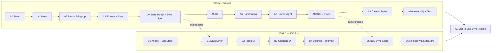
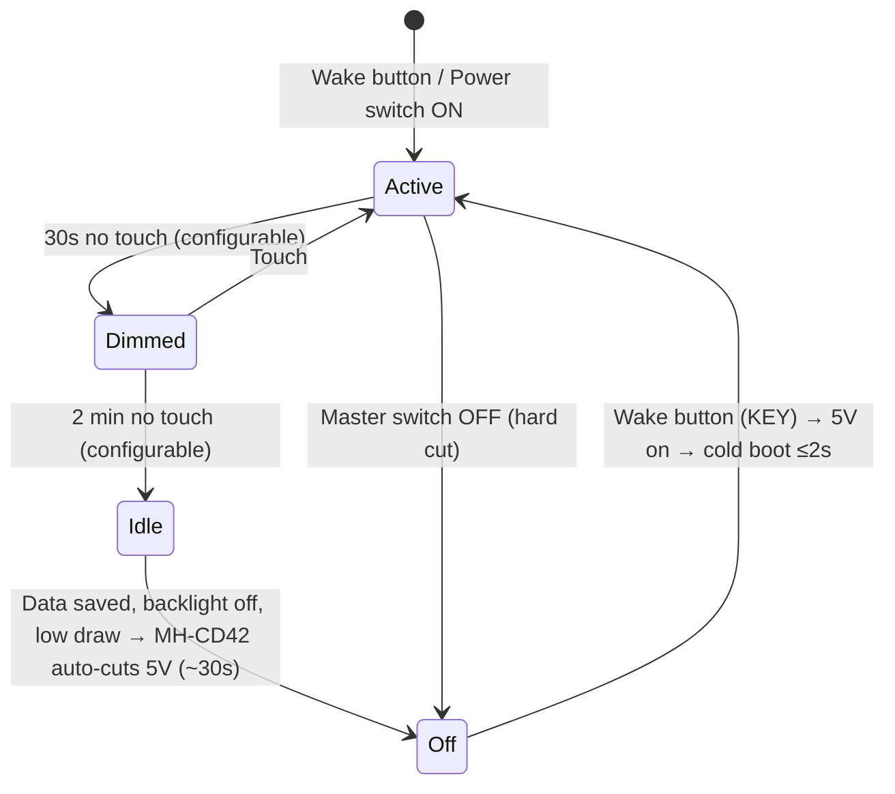
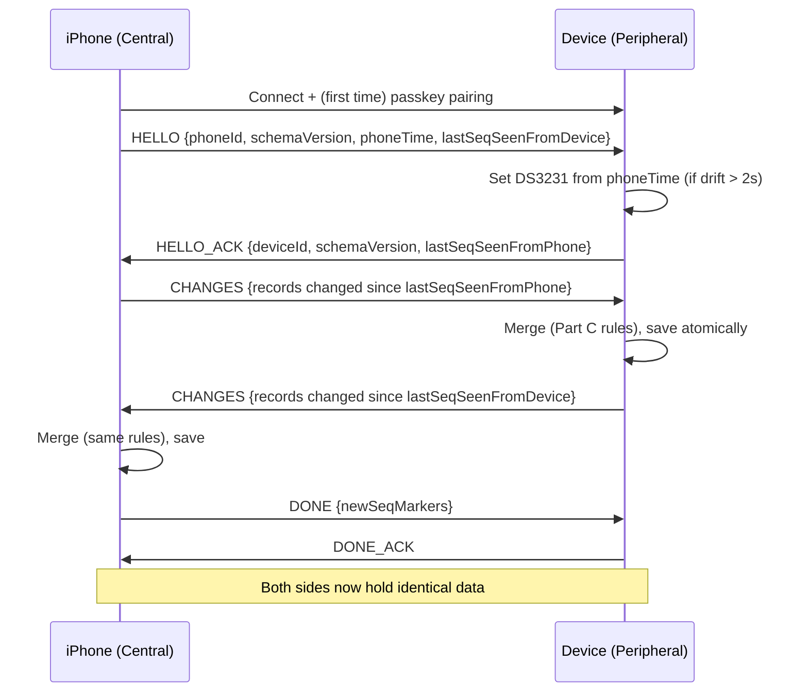

# Implementation Plan — Calendar / Task Manager (Device + iOS App)

This plan covers how the whole project gets built, from ordering parts to the finished tablet and the iPhone 12 app syncing over Bluetooth. It is based on:
- [idea.md](file:///home/diego/Personal-Projects/task-calendar/idea.md): requirements
- [circuit_and_components.md](file:///home/diego/Personal-Projects/task-calendar/circuit_and_components.md): chosen hardware and wiring
- [device_sketch.jpeg](file:///home/diego/Personal-Projects/task-calendar/drawings/device/device_sketch.jpeg): physical layout and UI

> [!IMPORTANT]
> **Order of work:** **Part A (the device)** comes first. **Part B (the iOS app)** comes second. **Part C (sync and conflict resolution)** is a shared spec. It gets designed during Part A, Phase A4, because the device and the app must both follow it exactly. Each phase ends with a **"Done when"** checklist. Don't start the next phase until that list is ticked off.

---

## 0. Overview



### Project Folder Structure

All work stays inside `/home/diego/Personal-Projects/task-calendar/`:

```text
task-calendar/
├── idea.md                       # Requirements (source of truth)
├── hardware_research.md          # Hardware options research
├── circuit_and_components.md     # Chosen BOM + wiring diagrams
├── implementation_plan.md        # This file
├── drawings/                     # Sketches (device_sketch.jpeg, app sketches later)
├── docs/
│   ├── data_model.md             # Shared Task/Event schema (Phase A4)
│   ├── sync_protocol.md          # BLE GATT + message format + conflict rules (Phase A4)
│   └── test_vectors/             # Shared JSON merge test cases (used by firmware AND app)
├── firmware/                     # PlatformIO project for the ESP32-8048S070C
├── handwriting/                  # Python training scripts + exported model
├── enclosure/                    # CAD source files + STL exports (case, stylus, button cap)
└── app/                          # Xcode project (TaskCalendar iOS app)
```

---

# PART A — THE DEVICE

## Phase A0 — Workspace & Tooling Setup

| Step | Action |
| :--- | :--- |
| A0.1 | Run `git init` in `task-calendar/` and add a `.gitignore` (PlatformIO `.pio/`, Xcode `DerivedData/`, `*.xcuserstate`, Python `venv/`). |
| A0.2 | Install **VS Code + PlatformIO extension** on the Linux machine (firmware). |
| A0.3 | Install **Python 3.11+** with a `venv` in `handwriting/` (TensorFlow, NumPy, Pillow) for training the handwriting model. |
| A0.4 | Choose CAD software for the case: **Onshape** (free, browser) or **Fusion 360** (free personal licence). Install your slicer (Cura / PrusaSlicer / Bambu Studio). |
| A0.5 | Make sure you have the basic electronics tools: soldering iron, solder, wire, **multimeter** (essential for Phase A2), side cutters, Kapton or electrical tape, and a USB-C data cable. |

**Done when:** the repo is initialised, PlatformIO can build an empty ESP32-S3 project, and the folder structure above exists.

---

## Phase A1 — Procurement & Incoming Inspection

### A1.1 Order List (from [circuit_and_components.md](file:///home/diego/Personal-Projects/task-calendar/circuit_and_components.md))

| # | Part | Search Term | Est. |
| :- | :--- | :--- | :--- |
| 1 | 7.0" display + ESP32-S3 | `ESP32-8048S070C` / `JC8048W570C` (**C = capacitive**) | £21.00 |
| 2 | Charge & 5V boost module | `MH-CD42` Type-C 5V 2A charge discharge module | £1.20 |
| 3 | Panel-mount USB-C socket | `JRC-C009` **2-pin** USB-C female | £0.60 |
| 4 | LiPo battery | 3.7V 3000–4000mAh pouch cell **with PCM protection**, ≤ ~95×60mm | £5.50 |
| 5 | Master slide switch | `SS12D00G4` SPDT | £0.50 |
| 6 | RTC module | `DS3231` (ZS-042 or Mini) + `CR2032`/`LIR2032` | £1.50 |
| 7 | Matte screen film | Matte "Paperlike" PET protector (≥7") | £1.50 |
| 8 | Capacitive stylus tips | Replacement precision disc / mesh fibre tips | £1.50 |
| 9 | Small passives *(see A2.6 / A7)* | 1× `1N5819` Schottky, 2× `1MΩ` resistors, 1× `100nF` ceramic cap | ~£1.00 |
| | **Total** | | **~£34.30** |

> [!TIP]
> Order the display first because it takes the longest to ship, and you can start firmware work (Phases A3–A5) on the display alone over its built-in USB port while the other parts arrive.

### A1.2 Incoming Inspection (as each part arrives)
1. **Display:** plug it into USB-C and confirm the factory demo boots and responds to touch. Note the board revision printed on the PCB.
2. **LiPo:** measure the voltage with a multimeter (it should read **3.6–4.0V**). Check that it isn't puffed or dented and that the PCM board is present. Store it in a fire-safe place.
3. **MH-CD42:** check the pads for solder bridges.
4. **DS3231:** fit the coin cell. If you're using a **non-rechargeable CR2032** on the ZS-042 board, remove the charging diode/resistor (see [circuit_and_components.md](file:///home/diego/Personal-Projects/task-calendar/circuit_and_components.md)).
5. **Measure the actual display board** with calipers: outline, mounting holes, header positions, and the thickness of the board plus components. Save the numbers to `enclosure/measurements.md`. They are needed in Phase A9.

**Done when:** every part has been received, inspected, and measured.

---

## Phase A2 — Bench Bring-Up (Breadboard / Loose Wiring)

Test each subsystem **on its own** before anything is assembled.

| Step | Test | Pass Criteria |
| :--- | :--- | :--- |
| A2.1 | **Display test sketch:** PlatformIO + `Arduino_GFX` or `ESP32_Display_Panel`, using the RGB pin map in [circuit_and_components.md §5B](file:///home/diego/Personal-Projects/task-calendar/circuit_and_components.md). Fill the screen with colours and gradients. | Full 800×480 with no drift, tearing or flicker. |
| A2.2 | **Backlight PWM** on `GPIO 2`, 0–100%. | Smooth dimming, and fully off at 0. |
| A2.3 | **GT911 touch** over I2C (`GPIO 19/20`, RST `GPIO 38`). Print the coordinates over serial. | The corners map correctly to 0,0 → 799,479. |
| A2.4 | **Stylus test:** build a quick stylus prototype (tip + foil + wire) and try it with and without the matte film. | Reliable touch-down, drag and lift-off through the film, with no dropouts while drawing slow lines. |
| A2.5 | **DS3231 RTC:** wire it to P3/P4 and use the `RTClib` library. Set the time, cut the power, and read the time back. | Time survives a power cycle. I2C scan shows `0x68` and the GT911 (`0x5D` or `0x14`). |
| A2.6 | **MH-CD42 power test, done with a multimeter BEFORE connecting the display:** <br>① Battery on `BAT`/`GND` and USB-C on `VIN`/`GND`: check `OUT-5V` reads **~5.0–5.15V**. <br>② **Measure the voltage on the `KEY` pad at rest** and write it down. <br>③ Short `KEY` to `GND` briefly and confirm the output switches on. <br>④ Check the light-load auto-off: with the output loaded at <50mA, does it switch off after ~30s? | 5V output is stable. The KEY voltage is known. The auto-off behaviour is confirmed. |
| A2.7 | **Full power path:** MH-CD42 → switch → display `P1` (+5V/GND). Run the display at 100% brightness and measure the current. | No brownout resets. Write down the current at 100%, 50%, and backlight off (this is needed for the battery estimate in A7). |
| A2.8 | **Charge while running:** plug in USB-C with the display running. | No reset when plugging in or unplugging, and the charge LEDs work. |

> [!NOTE]
> **Wake button wiring:** the `1N5819` diode that keeps the `KEY` pad's voltage (up to 4.2V) away from `GPIO 18` is now in [circuit_and_components.md §5B](file:///home/diego/Personal-Projects/task-calendar/circuit_and_components.md). During A2.6, also check that `GPIO 18` reads **HIGH** with the button released and **LOW** when pressed, and that `GPIO 17`/`GPIO 18` aren't already used by something on your board revision (§5 warning).

**Done when:** every row in the table passes, and the measured KEY voltage, current draws, and auto-off timing are recorded in `docs/bench_results.md`.

---

## Phase A3 — Firmware Foundation

### A3.1 Toolchain & Libraries

| Purpose | Choice | Reason |
| :--- | :--- | :--- |
| Build system | **PlatformIO**, `espressif32` platform, Arduino framework (on ESP-IDF 5.x) | Easy library management. Can drop to ESP-IDF APIs when needed. |
| Display driver | **`ESP32_Display_Panel`** (or `Arduino_GFX` `RGBPanel`) | Supports the ST7262/EK9716 16-bit RGB panels on Sunton 7" boards. |
| GUI | **LVGL 9.x** | Smooth animations, drag-and-drop, lists, and the 60 FPS target. |
| Touch | GT911 driver (from `ESP32_Display_Panel` or `TAMC_GT911`) | |
| RTC | `RTClib` (DS3231) | |
| BLE | **`NimBLE-Arduino`** | Much less RAM and flash than Bluedroid. Supports LE Secure Connections. |
| Storage | **LittleFS** on the 16MB flash | Power-loss-safe filesystem. |
| Serialization | `ArduinoJson` 7 | Same JSON format as the iOS app. |
| Host unit tests | PlatformIO `native` environment + Unity | Tests the data model and merge logic on the PC, without the board. |

### A3.2 Firmware Architecture

```text
firmware/
├── platformio.ini            # envs: [esp32s3_8048s070c], [native] (tests)
├── include/
│   └── board_pins.h          # every GPIO in ONE place (RGB, touch, backlight, I2C, button, battery ADC)
├── src/
│   ├── main.cpp              # boot sequence + main loop / FreeRTOS tasks
│   ├── hal/                  # hardware layer
│   │   ├── display.cpp       # RGB panel init, bounce buffers, LVGL flush
│   │   ├── touch.cpp         # GT911 → LVGL input device
│   │   ├── backlight.cpp     # PWM, fade in/out
│   │   ├── rtc.cpp           # DS3231 read/set, minute tick
│   │   ├── button.cpp        # wake button (GPIO 18) debounce
│   │   └── battery.cpp       # ADC → % (GPIO 17, optional)
│   ├── model/                # pure C++, no hardware: used by native tests
│   │   ├── task.h / event.h  # schema from docs/data_model.md
│   │   ├── store.cpp         # CRUD, ordering, completion rules
│   │   ├── hlc.cpp           # hybrid logical clock (for sync)
│   │   ├── merge.cpp         # conflict resolution (Part C rules)
│   │   └── recurrence.cpp    # yearly birthday/holiday occurrences (−2y … +5y window)
│   ├── storage/
│   │   └── persist.cpp       # LittleFS load/save, atomic writes, journal
│   ├── sync/
│   │   └── ble_service.cpp   # NimBLE GATT server + sync session state machine
│   ├── hwr/                  # handwriting recognition (Phase A6)
│   ├── power/
│   │   └── power_mgr.cpp     # active → dim → idle/off state machine
│   └── ui/
│       ├── theme.cpp         # fonts, colours, styles
│       ├── nav_bar.cpp       # Tasks | Calendar | Settings bottom bar
│       ├── screen_tasks.cpp
│       ├── screen_calendar.cpp
│       ├── screen_settings.cpp
│       └── widgets/          # task row, event block, popup, handwriting pad, keyboard
└── test/                     # native unit tests (model, merge, HLC, ordering)
```

### A3.3 Key Technical Settings (Known Pitfalls on ESP32-S3 RGB Panels)
1. **Framebuffers in PSRAM** (2 × 800×480×2 bytes = 1.5MB), with LVGL in **direct/full-refresh double-buffer** mode.
2. **Enable bounce buffers** (`bounce_buffer_size_px = 10 × 800`) and keep PCLK modest (~14–16MHz). Without these, the image **shifts or drifts** whenever flash is written or PSRAM is busy.
3. **Flash writes (saving data) can briefly stall PSRAM.** Batch saves (debounce ~1–2s after the last edit), and always use bounce buffers.
4. Run LVGL in **its own FreeRTOS task pinned to core 1**, and BLE plus storage on core 0. Guard all LVGL calls with a mutex.
5. Build with `-DBOARD_HAS_PSRAM`, PSRAM mode **OPI**, flash mode **QIO 80MHz**, and a partition table with a large LittleFS partition (e.g. 3MB app + ~8MB LittleFS + room for the handwriting model).

### A3.4 Boot Sequence
`power on → init backlight (off) → init RGB panel → draw splash → init RTC → mount LittleFS → load data → reconcile time-based task completion → build UI → fade backlight in → start BLE advertising`
**Target:** usable screen within **≤2 seconds** of pressing the wake button. This matters because idle uses a full power-off (see Phase A7).

**Done when:** the firmware boots to an empty three-tab shell with a working bottom nav bar, touch, backlight, and RTC time in the header, and `pio test -e native` runs.

---

## Phase A4 — Data Model, Persistence & Shared Sync Spec

Design this **once** and write it to `docs/data_model.md` and `docs/sync_protocol.md`. The iOS app (Part B) implements the exact same spec.

### A4.1 Data Model

**Task**
| Field | Type | Notes |
| :--- | :--- | :--- |
| `id` | UUID string | Generated on the device that creates the task. |
| `title` | string (≤120 chars) | |
| `parentId` | UUID \| null | `null` = parent/top-level. **One level only:** a task whose `parentId` is set can never have children. **`parentId` cannot change after creation** (children can't move between parents, as required by [idea.md](file:///home/diego/Personal-Projects/task-calendar/idea.md#L69)). |
| `sortKey` | string (fractional index) | Ordering inside its list. Dragging changes **only the moved task's** key (the new key goes between its neighbours), so a drag never rewrites the whole list, which keeps sync simple. |
| `completed` | bool | |
| `completedAt` | timestamp \| null | Orders the Completed list. |
| `collapsed` | bool | Subtasks hidden or shown (per-device UI state, **not synced**). |
| `linkedEventId` | UUID \| null | Set when the task was created from a calendar event. |
| `hlc` | map: field → HLC | Hybrid Logical Clock of the last change **to each field** (see A4.3). Per-field clocks are what make field-level merging possible (Part C2 rule 1). |
| `createdHlc` | string | HLC at creation. Used by full reconciliation (C2.1) to tell "deleted on the other side" apart from "new on this side". |
| `deleted` | bool | Tombstone. **Kept for 5 days**, then purged. |

**Event**
| Field | Type | Notes |
| :--- | :--- | :--- |
| `id` | UUID | |
| `title` | string | |
| `type` | enum `normal` \| `birthday` \| `holiday` | Default `normal`. Each type has a colour/icon. **The type sets the timing and repeat rules below.** |
| `allDay` | bool | `false` for `normal`. **Always `true` for `birthday` and `holiday`.** |
| `start`, `end` | timed: local datetime (`YYYY-MM-DDTHH:MM`) · all-day: date (`YYYY-MM-DD`) | Timed: `end > start`, snapping to 15 minutes in the UI. All-day: `end ≥ start` (a holiday can span several days). |
| `recurrence` | enum `none` \| `yearly` | `none` for `normal`. **`yearly` for `birthday` and `holiday`.** |
| `createsTask` | bool | "Also add as task" button ([idea.md](file:///home/diego/Personal-Projects/task-calendar/idea.md#L81)). **Only offered for `normal` events.** |
| `taskId` | UUID \| null | The linked task. |
| `hlc`, `createdHlc`, `deleted` | | Same as Task. |

**Rules the model enforces (on both device and app):**
1. Completed tasks live only in the Completed list, and uncompleted tasks only in the active list. Dragging can never cross between them.
2. **Completing a parent completes all of its subtasks.** Un-completing a parent moves it and all of its subtasks back to the active list as not done.
3. **Setting: "Complete parent when all subtasks are done"** (off by default). When it's on, ticking off a parent's last remaining subtask completes the parent automatically (only for parents with at least one subtask). Whatever the setting, un-completing a subtask of a completed parent also un-completes the parent, because a subtask can't be active while its parent sits in the Completed list. The setting is **synced** between the tablet and the app (see *Shared settings* below), so both behave the same.
4. **Event-linked auto-completion:** at every minute tick, on boot, and after every sync, any task whose linked event has `end ≤ now` is marked `completed` with `completedAt = event.end`. This is why the RTC matters: it still works after the device has been switched off.
5. Editing a linked event's time to a later end re-evaluates its task.
6. Rules 2–5 run again after every sync, so both sides end up in the same state.

**Birthdays & holidays (recurring all-day events):**
| Rule | Birthday | Holiday |
| :--- | :--- | :--- |
| All-day | ✅ Always | ✅ Always (can span several days, e.g. a week away) |
| Repeats | Every year on the same date | Every year on the same date(s) |
| Shown in the calendar | From **2 years ago** up to **5 years ahead** of today | Same window *(assumed; see Open Decisions)* |
| Past occurrences | Older than **2 years** → removed | Same *(assumed)* |
| 29 February | Shown on 28 Feb in non-leap years | Same |
| Editing | Changes every occurrence (no one-off exceptions in v1) | Same |

**How it's stored:** each birthday or holiday is **one record** with `recurrence = yearly`. The calendar **generates the yearly occurrences on the fly** for the window (today − 2 years → today + 5 years), so no occurrence outside that window exists anywhere. As time passes, old occurrences drop out of the window automatically. That's how "past birthdays are deleted after two years" works without a clean-up job. Deleting the birthday itself deletes the record (and every occurrence) as normal.

**Shared settings (synced):**
| Setting | Default | Synced? |
| :--- | :--- | :--- |
| `autoCompleteParent` (rule 3) | Off | ✅ Yes, the most recent change wins (Part C2 rule 10) |
| Brightness, timeouts, theme, handwriting mode | — | ❌ No, each device keeps its own |

### A4.2 Persistence (LittleFS)
- Files: `/tasks.json`, `/events.json`, `/meta.json` (device id, HLC state, last-sync markers per paired phone, settings).
- **Atomic writes:** write to `tasks.json.tmp`, `fsync`, then rename over `tasks.json`. A power cut (the MH-CD42 auto-off, or flicking the master switch) can then **never corrupt data**.
- Saves are debounced ~1–2s after the last edit, plus an **immediate save before entering idle** (A7).
- Expected size: even 2,000 tasks plus 2,000 events is under 1MB.
- **Tombstone purge:** deleted records older than **5 days** are removed for good at boot and after each sync.

### A4.3 Sync Foundations (Detailed in Part C)
- **Hybrid Logical Clock (HLC)** on every change: `wallclock_ms : counter : nodeId`. This gives a total ordering of edits that copes with small clock differences between the phone and the device.
- Each side keeps a **local change log sequence number**, so a sync only exchanges records changed since the last sync.

**Done when:** `docs/data_model.md` and `docs/sync_protocol.md` are written, the `model/` code passes native unit tests (ordering, one-level rule, completion rules, auto-complete, tombstones), and data survives a power cut during a save (test by pulling power repeatedly while saving).

---

## Phase A5 — Device UI (LVGL)

Build the UI from [device_sketch.jpeg](file:///home/diego/Personal-Projects/task-calendar/drawings/device/device_sketch.jpeg) in **landscape 800×480**. Design rules from [idea.md](file:///home/diego/Personal-Projects/task-calendar/idea.md#L60):
- Paper look: off-white background, dark ink-coloured text, and thin rule lines like a notebook.
- Every transition animated (150–250ms ease-out), with 60 FPS as the target.
- Hit targets of at least **48×48px**, because a stylus disc tip is ~6mm.

### A5.1 App Shell & Navigation
- Bottom bar: **`[✓] Tasks | [📅] Calendar | [⚙] Settings`**. The active tab is highlighted, and screens slide horizontally when switching.
- Top-right status area: time, battery %, Bluetooth connected/syncing icon.

### A5.2 Task Manager Screen
| Feature ([idea.md](file:///home/diego/Personal-Projects/task-calendar/idea.md#L64-L70)) | Implementation |
| :--- | :--- |
| Active list + Completed list | Two sections. The Completed section is collapsible and sits below the active list (or in a right-hand column, since the screen is landscape). |
| Add task | A "+ New task" row that opens the **handwriting pad** (A6). |
| Single tap on a parent → add subtask | Tap opens a small action strip (`+ Subtask`, `Edit`, `Delete`). *(Tapping the title area adds a subtask; the checkbox and chevron keep their own actions.)* |
| Checkbox → complete | Strike-through and fade animation (~300ms), then the row **animates down into the Completed list**. **Completing a parent ticks all its subtasks** (quick staggered ticks) and the whole group moves together. Tapping the checkbox in the Completed list restores it (a parent comes back with its subtasks). With "Complete parent when all subtasks are done" turned on, ticking the last subtask completes the parent too. |
| Tap-and-hold → drag | LVGL long-press (≈400ms) lifts the row (shadow + slight scale). Dragging shows a gap where it will land. Drop is **limited to the same list**. Subtasks are **limited to their own parent** (the drop zone is clamped to the parent's children). |
| Hide/show subtasks | A chevron button **only on parents that have children**. Expand/collapse height animation. |
| Delete | From the action strip, with a confirmation popup. Deleting a parent also deletes its children. |

### A5.3 Calendar Screen
| Feature ([idea.md](file:///home/diego/Personal-Projects/task-calendar/idea.md#L72-L81)) | Implementation |
| :--- | :--- |
| Left: month grid (`M T W T F S S`) | 7×6 grid. Today is circled and the selected day highlighted. Small coloured dots under days that have events (colour = type). Swipe or arrows change the month. |
| Right: timeline of the selected day | Scrollable 24h column (default scroll = now or 08:00). Hour rules. Events drawn as rounded blocks sized by duration. Overlapping events sit side by side. A red "now" line on today. An **all-day strip** pinned above the hours shows birthdays and holidays. |
| Tap a day → timeline | Updates the right panel with a quick cross-fade. |
| Tap-and-hold on timeline → new event | Opens the **Event popup** pre-filled with start = the pressed time (snapped to 15 min) and end = start + 1h. |
| Event popup | Title (handwriting pad), Start/End (roller pickers), **Type dropdown** (Normal/Birthday/Holiday), **"Also add as task" toggle**, Save/Cancel/Delete. Picking **Birthday** or **Holiday** swaps the time pickers for date picker(s) (a holiday can have an end date), shows "Repeats every year", and hides "Also add as task". |
| Tap an existing event | Opens the same popup in edit mode. |

### A5.4 Settings Screen
- **Bluetooth:** on/off, "Pair new phone" (shows a 6-digit passkey on screen), list of paired phones, "Forget", last sync time, "Sync now".
- **Tasks:** "Complete parent when all subtasks are done" toggle (off by default, synced with the app).
- **Display:** brightness slider, dim timeout, sleep timeout.
- **Date/Time:** manual set (normally set automatically by the phone during sync), 12h/24h, week starts Monday/Sunday.
- **Handwriting:** input mode (handwriting / keyboard), pause time before recognition (default 0.7s), "Add my handwriting samples" (data collection mode, A6.4), "Reset my saved words".
- **About:** firmware version, battery %, storage used, factory reset (with confirmation).

**Done when:** every row of every table above works on the device with the stylus, animations are smooth with no visible tearing, and a UI walkthrough matches the sketch.

---

## Phase A6 — Handwriting Recognition

**Status: agreed 2026-11-09.** Handwriting is **non-cursive (separate printed letters), written freely along a ruled line, with no boxes**. It is recognised **on the tablet, fully offline**.

> [!NOTE]
> This is the **hardest part of the device**, and its accuracy can't be guaranteed in advance. It depends on how neatly the letters are separated and on how well the model learns your handwriting. The plan therefore has **a working fallback at every stage**, so the project is never blocked by this phase. Cursive (joined-up) writing is **not supported**.

### A6.0 The Writing Pad (What It Feels Like)
- Tapping "+ New task" (or a title field) opens a **pad along the bottom of the screen**: one or two ruled lines like notebook paper, with a **keyboard button** always visible.
- You write a word or a whole title in separate printed letters, left to right. Your ink stays on screen as you write.
- **Recognition runs after a pause of ~0.7s** (adjustable in Settings). The ink turns into text above the line. A **suggestion strip** shows alternatives for the least certain letters, and one tap swaps a letter.
- **Editing:** scribble over a letter to delete it, or tap a letter in the text to correct it. A long press on the text line moves the cursor.
- **Tip for best accuracy:** write in **capital letters or clear printed lowercase** at a consistent size.

### A6.1 Stages (Each One Works On Its Own)

| Stage | Approach | Notes |
| :--- | :--- | :--- |
| **Stage 0 (fallback, build first)** | On-screen **QWERTY keyboard** (LVGL `lv_keyboard`). | Titles can always be entered, from day one. |
| **Stage 1 (main, on-device)** | **Free-line printed writing:** the pad splits your ink into letters (A6.2) and a small **int8 CNN** reads each one on the ESP32-S3 (**TensorFlow Lite Micro** or **ESP-DL**). A word list and scoring pass (A6.3) then corrects likely mistakes. | A model of ~50–150KB should take roughly 10–40ms per letter, so a 10-letter title is recognised in well under a second after you pause. |
| **Stage 1b (safety net, only if segmentation is unreliable)** | **Boxed input:** the same recogniser, but with one letter per box, so there is nothing to split. Switchable in Settings. | Not built unless Stage 1 testing shows the free-line version isn't good enough. |
| **Stage 2 (optional upgrade, later)** | **Free-form writing read by the iPhone:** when the phone is connected, the device sends the ink over BLE and the app uses Apple's **Vision** text recognition, then sends the text back. Offline it falls back to Stage 1. | Better accuracy and could even handle cursive, but needs the phone nearby. Only started if you want it after Stage 1 is working. |

### A6.2 Splitting Ink Into Letters (Segmentation)
The tablet records every stroke as `(x, y, time)` points, which is what makes splitting possible:
1. **Group strokes into letters:** strokes that **overlap horizontally** (the bars of `E`, `F`, `H`, `A`; the cross of `t` or `x`; the dot of `i`/`j`) belong to **one letter**. A stroke that starts well to the right of the previous letter's right edge starts a **new letter**.
2. **Letter gap vs word gap:** the gap threshold is **relative to your letter height**, not a fixed pixel size. A small gap means the next letter. A gap of roughly **half a letter height or more** inserts a **space**.
3. **Time as a hint:** a long pause between strokes counts as a gap too, which helps when two letters are close together.
4. **Baseline and size:** the pad estimates the baseline and letter height from your writing. This helps tell `o`/`O`, `c`/`C`, `s`/`S`, `p`/`P` apart by size, and keeps `i`/`j` dots with their letters.
5. **Letters that touch or overlap:** if two letters touch, they come out as one blob. The recogniser gives that blob a low score, and the pad then retries by splitting it vertically at the narrowest point. If the retry also scores low, it flags the blob in the suggestion strip so you can rewrite it.

### A6.3 Recognising Letters and Fixing Likely Mistakes
1. Each letter is cropped, scaled and fed to the CNN, which gives a **score for every character** (A–Z, a–z, 0–9, and basic punctuation such as `. , : - / ' !`).
2. **Context pass** over the whole word:
   - **Digits vs letters:** inside words, prefer letters (`0` → `O`); next to other digits or `:` and `/`, prefer digits (`15:00`).
   - **Look-alikes** (`O`/`0`, `I`/`l`/`1`, `S`/`5`, `B`/`8`, `Z`/`2`): resolved from the neighbouring characters and the word list.
   - **Word list:** a compact English word list (~20–30k words, a few hundred KB in flash) plus **your own saved words** (task titles you've already used, since people repeat things like "Meeting" or "Groceries"). When a word is one or two letters away from a known word, and the model's scores agree, it is corrected. **Anything not in the word list (names, abbreviations) is left exactly as written**, never forced into a wrong word.
3. The **top 3 alternatives** per letter feed the suggestion strip.

### A6.4 Model Training (`handwriting/`)
1. **Starting data:** **EMNIST Balanced** (digits plus upper/lower-case letters, 47 classes where some look-alike lower-case letters are merged). It has no punctuation, so punctuation and the remaining lowercase classes come from **your own samples**.
2. **Model:** two or three small conv layers + a dense layer, trained with **int8 quantisation-aware training**.
3. **Export** to `.tflite`, convert to a C array (`xxd -i`) → `firmware/src/hwr/model_data.cc`.
4. **Training on your own handwriting (the biggest accuracy gain):** a **"data collection mode"** in the firmware saves letters written with **your stylus on this tablet**, rendered exactly as the device renders them, and sends them over USB. Collect **~30 samples of each character**, written both singly and in words (so the real letter-splitting is also exercised). Fine-tune the model on them. Repeat after the case and matte film are on, because the feel of the film changes how you write.
5. **Held-out test set:** keep ~20% of your samples out of training to measure real accuracy.

### A6.5 Pre-processing (Identical in Training and on the Device)
Stroke points → bounding box → scale so the long side is 20px, centred in 28×28 → line thickness ~2px → slight blur. **Using identical pre-processing in both places is the main factor in accuracy.** The same code (or a tested port of it) is used in the Python training scripts and the firmware, and a unit test checks they produce the same image for the same strokes.

### A6.6 Build Order (So Something Always Works)
1. Stage 0 keyboard.
2. Writing pad that captures and draws ink (no recognition).
3. Data collection mode, then collect your samples.
4. Train the model, check accuracy on the test set **in Python first**.
5. Segmentation (A6.2), tested on **recorded stroke files** on the PC (`pio test -e native`).
6. Put the model on the device and run the recogniser on its own, one letter at a time.
7. Join it all together with the context pass (A6.3), and tune the pause time.
8. Re-collect samples through the matte film and retrain if needed.

### A6.7 Targets and "Done When"
| Measure | Target |
| :--- | :--- |
| Single-letter accuracy (your handwriting, held-out set) | ≥ 95% |
| Letters split correctly in a normal word | ≥ 95% |
| Time from pausing to text appearing | < 1 second for a 15-letter title |
| Typical 3-word title | ≤ 1 correction on average |

**Done when:** you can write a typical 3-word task title in under ~15 seconds with at most 1 correction on average, the keyboard fallback works, and the targets above are met. **If the accuracy targets can't be met after a fair attempt** (retraining on more of your samples), the fallback is Stage 1b (boxed input) rather than lowering the bar, and Stage 2 (iPhone reading) stays available.

---

## Phase A7 — Power Management & Battery

### A7.1 Power States



- **Idle / Off model:** before idling, the firmware **saves all data**, turns the backlight off, stops BLE, and puts the ESP32 into deep sleep. The low current then makes the `MH-CD42` cut the 5V output, which means **zero power draw** (only the RTC coin cell keeps time). Pressing the wake button pulls `KEY` low, the 5V comes back, the device cold-boots, and the last screen is restored.
- **Fallback, if A2.6 shows the auto-off is unreliable:** keep the ESP32 in deep sleep with `ext0` wake on `GPIO 18` instead (draws a little more, still days of standby).
- **Restoring "where I was":** save the current tab, selected day, and scroll position to `meta.json` before idling.

### A7.2 Battery Level (Optional but Recommended)
The `MH-CD42` only has 4 LEDs and doesn't tell the ESP32 the battery level. For a % icon in the UI:
- **Divider:** `BAT+ → 1MΩ → GPIO 17 → 1MΩ → GND`, plus `100nF` from `GPIO 17` to `GND`. High resistor values mean only ~2µA of constant drain. `GPIO 17` is on ADC2, which is fine because Wi-Fi isn't used.
- Convert voltage to % with a LiPo discharge curve lookup table (4.20V = 100%, 3.70V ≈ 40%, 3.40V ≈ 5%). Average over 16 samples, and only sample while the backlight is steady.

### A7.3 Battery Life Targets (Check Against A2.7 Measurements)
| State | Rough draw | Estimated runtime (3000mAh) |
| :--- | :--- | :--- |
| Active, 100% backlight | ~2.5W | ~3.5–4h |
| Active, 50% backlight | ~1.5W | ~6h |
| Off (MH-CD42 cut) | ~µA | months (battery self-discharge) |

**Done when:** the device reliably goes Active → Dimmed → Idle → Off and back on with the wake button, no data is ever lost across that cycle, and the battery % is within ±10%.

---

## Phase A8 — BLE GATT Service (Device Side)

Implements `docs/sync_protocol.md` (full details in **Part C**).

| Item | Choice |
| :--- | :--- |
| Role | Device = **peripheral / GATT server** (advertises). iPhone = **central** (connects). |
| Why BLE | iOS only allows non-MFi accessories over **Bluetooth Low Energy**. Classic Bluetooth serial won't work with an iPhone. |
| Security | **LE Secure Connections + passkey:** "Pair new phone" in Settings shows a 6-digit code on the 7" screen, and you type it on the iPhone. The device stores the bond. Only bonded phones can read or write the sync characteristics. |
| MTU | Request 247; handle the iOS-negotiated value (typically 185). Messages are split into chunks. |

**Custom service** (128-bit UUIDs generated once and stored in the spec):
| Characteristic | Properties | Purpose |
| :--- | :--- | :--- |
| `Info` | Read | Device id, firmware version, schema version, battery %. |
| `RX` (phone → device) | Write Without Response | Message chunks from the phone. |
| `TX` (device → phone) | Notify | Message chunks to the phone. |

**Message framing:** `[type:1][seq:2][totalLen:2][chunk…]`, with a **CRC32** over each full message. Messages are JSON matching the data model.

**Done when:** a generic BLE app (e.g. **nRF Connect** on the iPhone) can pair with a passkey, read `Info`, and exchange a test message. Unbonded connections are rejected.

---

## Phase A9 — Enclosure, Buttons & Stylus (3D Printing)

### A9.1 Case Design (from the sketch + A1.2 measurements)
- **Two-part shell:** a **front bezel** (frames the 7" glass and holds the wake-button cap) and a **back shell** (holds the battery, MH-CD42, RTC, and switch), joined with **M2/M3 screws into heat-set inserts** or printed clips.
- **Cut-outs and features, positioned as in the sketch:**
  | Feature | Location | Detail |
  | :--- | :--- | :--- |
  | Master slide switch | **Top edge, left** | Rectangular slot + 2 screw bosses for the `SS12D00G4` (or a press-fit pocket). |
  | USB-C charging port | **Left edge, upper** | Opening + 2 screw holes matching the `JRC-C009` faceplate. |
  | Wake button | **Bottom bezel, centre** | Wide pill-shaped printed cap on a flexible hinge or plunger pressing the tactile switch. |
  | Stylus holder | **Right edge** | Integrated C-clip or loop (or a magnet pocket). |
  | Display USB port | Internal only | Leave a removable hatch or slot so the ESP32's own USB-C stays reachable for **flashing firmware** after assembly. |
- **Battery bay:** a pocket with ~1mm clearance on every side and a foam pad. **Nothing sharp or hot near the cell.** The MH-CD42 goes away from the battery, with airflow gaps.
- **Wall thickness** 2.0–2.4mm. Glass lip overlap ~1.5mm. Tolerances: +0.3mm on all pockets.
- Print in **PETG** (more heat-resistant than PLA near the battery and backlight), 0.2mm layers, 3–4 walls.

### A9.2 Stylus (Option B)
- About 9–10mm diameter, ~140mm long, hexagonal or round grip. Hollow channel for the copper wire. Press-fit or threaded socket for the disc/mesh tip. **Conductive copper tape band** on the grip area.
- Print several tip-socket test pieces first to get the press-fit right.
- Test it through the matte film (A2.4 criteria).

### A9.3 Iteration Plan
1. Print a **thin test frame** (just the bezel outline) to check the display fits.
2. Print the **edge-feature test coupons** (switch slot, USB-C plate, button cap).
3. Print the full case.

**Done when:** all parts fit without forcing, the button press feels good, the USB-C and switch line up, and the screen sits flush.

---

## Phase A10 — Final Assembly & Device Testing

### A10.1 Assembly Order
1. Solder short wires to the `JRC-C009` (`V`, `G`) → `MH-CD42` (`VIN`, `GND`).
2. `MH-CD42 OUT-5V` → slide switch → display `P1` pin 1 (`+5V`). `MH-CD42 GND` → `P1` pin 4.
3. DS3231 → `P3` (`SCL`=GPIO 20, `SDA`=GPIO 19) and `P4` (`3V3`, `GND`).
4. Wake button + `1N5819` diode ([circuit_and_components.md §5B](file:///home/diego/Personal-Projects/task-calendar/circuit_and_components.md)) → `KEY` and `GPIO 18`. **Stripe (cathode) towards `KEY`.**
5. Battery level divider (`2× 1MΩ` + `100nF`, §5C) → `GPIO 17`.
6. **Connect the LiPo last**, after checking polarity with the multimeter. **Reversed polarity destroys the MH-CD42.**
7. Insulate every joint with heatshrink or Kapton. Secure the wires with tape or printed clips so nothing rubs on the battery.
8. Apply the matte film to the glass, then close the case.

### A10.2 Device Acceptance Tests
| # | Test | Pass |
| :- | :--- | :--- |
| 1 | Charges via USB-C with the switch OFF | LEDs show charging; cell reaches 4.2V and stops |
| 2 | Runs while charging; plugging/unplugging causes no reset | ✅ |
| 3 | Cold boot to usable UI | ≤2s |
| 4 | Every Task Manager feature in A5.2 | ✅ |
| 5 | Every Calendar feature in A5.3, including event → task, and auto-complete after the end time **even if the device was off at that moment** | ✅ |
| 6 | Handwriting targets (A6.7): ≥95% letter accuracy, <1s recognition, ≤1 correction per 3-word title | ✅ |
| 7 | Idle → Off → wake cycle × 50, then check data integrity | No loss |
| 8 | Hard power cut (switch OFF) during an edit × 20 | No corruption |
| 9 | RTC drift after 1 week | < ~2 s/week (the DS3231 is accurate to about ±2ppm) |
| 10 | Battery runtime at 50% brightness | ≥5h |
| 11 | Surface temperature after 1h use | Warm at most, never hot |

**Done when:** all 11 tests pass. **The device is complete and fully usable on its own, without the phone** (an [idea.md](file:///home/diego/Personal-Projects/task-calendar/idea.md#L3) requirement).

---

# PART B — THE iOS APP (iPhone 12, SideStore)

## Phase B0 — Mac, Xcode & SideStore Pipeline

| Step | Action |
| :--- | :--- |
| B0.1 | On the Mac, install **Xcode** (latest the Mac supports) and sign in with your **free Apple ID** (Xcode → Settings → Accounts). |
| B0.2 | Create the project in `task-calendar/app/`: **iOS App**, **SwiftUI**, **Swift**, storage **SwiftData**, minimum deployment **iOS 17** (the iPhone 12 runs iOS 17/18). Bundle id e.g. `com.diego.taskcalendar`. |
| B0.3 | Add to Info.plist: `NSBluetoothAlwaysUsageDescription` ("Used to sync with your Task Calendar tablet"). Under Background Modes, enable **"Uses Bluetooth LE accessories"** (`bluetooth-central`). |
| B0.4 | **Day-to-day development:** run directly on the iPhone over USB from Xcode (free provisioning). This is fastest for debugging, and BLE **doesn't work in the Simulator**, so a real device is needed for sync work anyway. |
| B0.5 | **Long-term install via SideStore:** set up SideStore on the iPhone following the official docs (docs.sidestore.io), including its pairing file and on-device VPN setup. Then: Xcode → **Product → Archive** → export the `.ipa` (or zip `Payload/TaskCalendar.app` into a `.ipa`) → send it to the phone (AirDrop/Files) → open SideStore → **"+" → install**. |
| B0.6 | **Free Apple ID limits:** apps must be **refreshed every 7 days** (SideStore can refresh in the background over Wi-Fi). There's a limit of 3 active sideloaded apps. All app data stays on the phone between refreshes. |

**Done when:** a "Hello" build installs through **both** Xcode and SideStore, and survives a SideStore refresh.

---

## Phase B1 — Data Layer (Same Spec as the Device)

```text
app/TaskCalendar/
├── TaskCalendarApp.swift
├── Model/
│   ├── TaskItem.swift        # @Model: id, title, parentId, sortKey, completed, completedAt, linkedEventId, hlc, createdHlc, deleted
│   ├── CalendarEvent.swift   # @Model: id, title, type, allDay, start, end, recurrence, createsTask, taskId, hlc, createdHlc, deleted
│   ├── EventType.swift       # enum normal / birthday / holiday (+ colour/icon, allDay/recurrence defaults)
│   ├── Recurrence.swift      # yearly occurrences within today −2y … +5y (same algorithm as firmware)
│   ├── SharedSettings.swift  # synced settings (autoCompleteParent) + HLC
│   ├── HLC.swift             # hybrid logical clock (same algorithm as firmware hlc.cpp)
│   ├── FractionalIndex.swift # sortKey generation (same algorithm as firmware)
│   └── TaskRules.swift       # one-level rule, completion rules, auto-complete-on-event-end
├── Sync/
│   ├── BLEManager.swift      # CoreBluetooth central (Phase B5)
│   ├── SyncSession.swift     # protocol state machine
│   ├── Framing.swift         # chunking + CRC32
│   └── Merge.swift           # conflict resolution (Part C rules)
├── Views/
│   ├── RootTabView.swift     # Tasks | Calendar | Settings
│   ├── Tasks/…
│   ├── Calendar/…
│   └── Settings/…
└── Tests/
    └── MergeTests.swift      # runs docs/test_vectors/*.json — must match the firmware results
```

- **Offline first:** SwiftData stores everything locally, with no network code anywhere ([idea.md](file:///home/diego/Personal-Projects/task-calendar/idea.md#L105-L107)).
- **Shared test vectors:** every merge and ordering rule has JSON test cases in `docs/test_vectors/`. The **firmware native tests and the Swift XCTests both run the same files**, which guarantees the two sides resolve conflicts identically.
- Auto-complete linked tasks on app launch, on returning to the foreground, on a 1-minute timer while open, and after every sync.

**Done when:** the model and rules unit tests pass, and all shared test vectors pass.

---

## Phase B2 — Task Manager UI (SwiftUI)

Matches the device's behaviour, adapted for touch ([idea.md](file:///home/diego/Personal-Projects/task-calendar/idea.md#L111-L117)):

| Feature | SwiftUI Implementation |
| :--- | :--- |
| Active + Completed lists | `List` with two `Section`s. The Completed section is collapsible. |
| Add task | "+" button → inline `TextField` row (iOS keyboard; dictation works for free). |
| Tap parent → add subtask | Tap opens an inline "Add subtask" field under the parent. |
| Checkbox complete | Animated checkmark, then `withAnimation(.spring)` moves the row to Completed (matched-geometry effect). Completing a parent completes its subtasks, and the "Complete parent when all subtasks are done" setting works exactly as on the tablet (A4.1 rules 2–3). |
| Tap-and-hold drag | `.onMove` / drag-and-drop with constraints: no moving between Active and Completed, and children only within their own parent. Updates only the moved item's `sortKey`. |
| Hide/show subtasks | `DisclosureGroup`-style chevron, **only shown when the parent has children**. |
| Swipe actions | Swipe to delete or edit (iOS convention, a small extra on top of idea.md). |
| Haptics | Light haptic on pick-up, drop, and complete. |

**Done when:** every behaviour matches the device's Task Manager rules and the A5.2 table.

---

## Phase B3 — Calendar UI

| Feature ([idea.md](file:///home/diego/Personal-Projects/task-calendar/idea.md#L119-L128)) | Implementation |
| :--- | :--- |
| Initial view: current month + weekdays | Custom `LazyVGrid` month view, swipe between months, type-coloured dots on days with events. |
| Tap day → timeline | Pushes or expands into a **day timeline** (vertical 24h `ScrollView`, hour lines, event blocks sized by duration, overlap layout, "now" line). *On the phone's portrait screen, month and timeline stack vertically or navigate, rather than sitting side by side as on the tablet.* |
| Tap-and-hold timeline → new event | `LongPressGesture` → reads the time at the press position (snapped to 15 min) → **event sheet** pre-filled. |
| Event sheet | Title, start/end `DatePicker`s, **Type picker** (Normal/Birthday/Holiday), **"Also add as task" toggle**, Save/Delete. Birthday/Holiday switch to date-only pickers, show "Repeats every year", and hide "Also add as task". |
| Birthdays & holidays | All-day strip at the top of the day timeline, plus marks on the month grid. Yearly occurrences come from the shared `Recurrence` code (2 years back to 5 years ahead), identical to the tablet. |
| Event → task + auto-complete | Same `TaskRules` as Phase B1. |

**Done when:** every row works and matches the device's behaviour.

---

## Phase B4 — Settings & Themes

- **Bluetooth:** list of nearby Task Calendar devices, pair (enter the passkey shown on the tablet), connection status, last sync time, "Sync now", "Forget device".
- **Themes** ([idea.md](file:///home/diego/Personal-Projects/task-calendar/idea.md#L132)): Paper (default, matching the device), Light, Dark, plus accent colour choice. Stored in `@AppStorage`.
- **Tasks:** "Complete parent when all subtasks are done" (synced with the tablet).
- **General:** week start day, 12h/24h, "Delete completed tasks older than…".
- **About:** app version, and the firmware version of the connected device.

**Done when:** themes apply across the whole app instantly, and Bluetooth settings drive the sync manager.

---

## Phase B5 — BLE Sync Client (CoreBluetooth)

| Item | Detail |
| :--- | :--- |
| Role | `CBCentralManager`. Scans for the custom service UUID, connects, and discovers `Info`/`RX`/`TX`. |
| Pairing | The first write to a protected characteristic triggers the iOS pairing dialog, where you enter the 6-digit code shown on the tablet. |
| When it syncs | ① On app launch or foreground, if the device is in range. ② After any local edit (debounced 3s) while connected. ③ "Sync now" button. ④ **Background:** state restoration (`CBCentralManagerOptionRestoreIdentifierKey`) plus a pending connect, so iOS wakes the app when the tablet comes into range and starts advertising. |
| Time sync | At the start of each session the phone sends its current time, and the device updates its DS3231. This keeps the clocks aligned and corrects RTC drift. |
| Robustness | Resume after disconnect from the last acknowledged chunk. Timeouts. All merge work runs in a background `ModelContext`. |

**Done when:** the app syncs with the finished device in both directions, including after a reconnect partway through a sync.

---

## Phase B6 — App Release & Maintenance via SideStore
1. Bump the version/build number → Archive → export `.ipa` → install or update via SideStore (data is kept on update as long as the bundle id is unchanged).
2. Keep SideStore's **auto-refresh** working (the phone needs Wi-Fi or its VPN setup periodically).
3. Keep `app/CHANGELOG.md` and tag releases in git (`app-v1.0.0`, `fw-v1.0.0`).

---

# PART C — SYNC PROTOCOL & CONFLICT RESOLUTION (Shared Spec)

> [!IMPORTANT]
> These rules were **agreed on 2026-11-04** and copied into the Conflict Resolution section of [idea.md](file:///home/diego/Personal-Projects/task-calendar/idea.md). They get written into `docs/sync_protocol.md` in Phase A4.

### C1. Sync Session Flow



- First sync with a new phone (no markers yet) sends **everything**.
- **If the last successful sync between the two was more than 5 days ago** (longer than tombstones are kept), the session runs in **full reconciliation** mode instead (C2.1).
- Schema version mismatch: the side with the newer schema converts, or refuses with a clear on-screen message ("Update app/firmware").

### C2. Conflict Resolution Rules (Agreed)

| # | Situation | Rule |
| :- | :--- | :--- |
| 1 | **The same task/event edited on both** since the last sync | **Field-level last-writer-wins:** each field (title, times, type, completed, sortKey) keeps the value with the newest HLC. Different fields edited on each side are **both kept** (e.g. title renamed on the tablet + completed on the phone gives both changes). |
| 2 | **Deleted on one side, edited on the other** | **Delete wins.** Tombstones (deletion markers) are kept for **5 days**. If the two sides go longer than that without syncing, full reconciliation (C2.1) makes sure deleted items still don't come back. |
| 3 | **Parent deleted on one side, new subtask added under it on the other** | **The orphaned subtask is deleted too**, along with its parent (this follows from rule 2). |
| 4 | **Completed on one side, un-completed on the other** | Newest HLC wins (rule 1). |
| 5 | **Both sides reordered the same list** | Each moved item's `sortKey` follows rule 1. Equal keys are tie-broken by `id`, then keys are re-spaced locally. The result is a deterministic order on both sides. |
| 6 | **Event times changed → linked task** | After merging, re-run the task rules (A4.1 rules 2–5) on both sides. |
| 7 | **Both sides created "the same" task independently** | Treated as two different tasks (different UUIDs). No guessing based on matching titles. |
| 8 | **Clock differences between phone and device** | HLC ordering + phone time setting the RTC at every sync. A timestamp skewed into the future can't permanently win, because the HLC advances past it. |
| 9 | **Ties** (identical HLC, practically impossible) | Higher `nodeId` wins. |
| 10 | **Shared setting changed on both** (e.g. "Complete parent when all subtasks are done") | The most recent change wins (HLC). |

#### C2.1 Full Reconciliation (When the Last Sync Was More Than 5 Days Ago)
Normally a sync only sends what has changed, and deletions travel as tombstones. Tombstones are purged after 5 days, so if the phone and tablet go longer than that without syncing, a delete could be "forgotten" and the other side would send the item back. To stop that:
1. Both sides exchange the **full list of record ids**, each with its `createdHlc`.
2. For a record that exists on one side but is missing on the other:
   - If it was created **before** the last successful sync (`createdHlc` ≤ last-sync marker), the other side already had it and has since deleted it, so it gets **deleted here too**.
   - If it was created **after** the last successful sync, it's simply new, so it gets **sent across**.
3. Records present on both sides then merge normally (rule 1).

### C3. Testing the Rules
- Each rule gets **at least 2 JSON test vectors** (`docs/test_vectors/rule_01_*.json` …) with `base`, `phoneChanges`, `deviceChanges`, and `expected`.
- **Firmware** (`pio test -e native`) and **app** (`MergeTests.swift`) must both produce `expected` for every vector.

---

# PART D — END-TO-END TESTING, MILESTONES & RISKS

## D1. End-to-End Test Scenarios (Device + App)
1. Create 10 tasks with subtasks on the tablet → sync → identical on the phone (order, nesting, completion).
2. Edit on both offline (rules 1–5 above) → sync → identical on both, matching the expected outcomes.
3. Create an event with "Also add as task" on the phone → sync → the task appears on the tablet → switch the tablet off → wait past the event end → switch on → the task is completed.
4. Pull the tablet's power partway through a sync → reconnect → sync completes and nothing is lost or duplicated.
5. Delete a few tasks on the phone, keep the tablet away for **6+ days**, then sync → the deleted tasks stay deleted on both (full reconciliation, C2.1).
6. Add a birthday → it appears every year up to 5 years ahead, in the all-day strip, identically on both. Move the device's date 3 years forward → occurrences more than 2 years old have gone.
7. Complete a parent on the tablet → all its subtasks are completed on both after syncing. Turn on "Complete parent when all subtasks are done" on the phone → after syncing, the setting is on and works on the tablet too.
8. One week of real daily use. Log every bug in `docs/bugs.md`.

## D2. Milestones

| Milestone | Contents | "It's real when…" |
| :--- | :--- | :--- |
| **M1** Hardware alive | A0–A2 | Screen, touch, stylus, RTC and power all pass bench tests |
| **M2** Standalone planner | A3–A5 | Tasks and calendar fully usable on the tablet (keyboard input) |
| **M3** Writes like paper | A6–A7 | Handwriting input + all-day battery behaviour |
| **M4** Finished device | A8–A10 | In its case, BLE service ready, all acceptance tests pass |
| **M5** Standalone app | B0–B4 | Full app working offline on the iPhone via SideStore |
| **M6** Connected system | B5–B6 + Part C + D1 | Both sync reliably, and conflicts resolve as specified |

## D3. Risks & Mitigations

| Risk | Impact | Mitigation |
| :--- | :--- | :--- |
| Handwriting accuracy too low, or touching letters split wrongly | Frustrating input | Keyboard fallback from day one, training on your own samples, word-list correction, and a boxed-input safety net (Stage 1b) if free-line splitting isn't reliable. Optional iPhone reading upgrade (Stage 2). Write in separate printed letters (cursive isn't supported) |
| RGB screen drift/tearing during flash writes | Visual glitches | Bounce buffers, moderate PCLK, debounced saves (A3.3) |
| `MH-CD42` auto-off triggers while in use, or never triggers | Random shutdowns, or battery drain | Measured in A2.6. Keep active draw >50mA (backlight on). Fall back to ESP32 deep sleep (A7.1) |
| `KEY` pad voltage > 3.3V | Damaged GPIO | `1N5819` diode isolation ([circuit_and_components.md §5B](file:///home/diego/Personal-Projects/task-calendar/circuit_and_components.md)) |
| Devices go more than 5 days without syncing | Deleted items come back | Full reconciliation mode (C2.1) |
| Capacitive stylus unreliable through the matte film | Missed strokes | Test early (A2.4). Try mesh vs disc tips, a thinner film, a larger tip, or GT911 sensitivity settings |
| LiPo safety | Fire or injury | Protected cell only, polarity check, no pinching or puncture in the case, PETG, never charge unattended during early testing |
| SideStore 7-day expiry | App stops opening | Auto-refresh. Data is never lost; re-sign when needed |
| Budget creep (~£34 vs £30 target) | Over budget | Biggest saving: batch AliExpress orders / sale coupons. Drop the matte film or battery divider if needed |

---

## Decisions Log

| Date | Decision |
| :--- | :--- |
| 2026-11-04 | Conflict rules agreed (Part C2), with two changes: tombstones are kept for **5 days**, and a subtask added under a parent that was deleted on the other side is **deleted too**. Full reconciliation (C2.1) added to cover the 5-day limit. Rules copied into idea.md. |
| 2026-11-04 | Completing a parent completes its subtasks. A synced setting, "Complete parent when all subtasks are done", completes the parent automatically (A4.1 rules 2–3). |
| 2026-11-04 | Birthdays repeat yearly, are all-day, show up to 5 years ahead, and occurrences more than 2 years old are removed. Holidays repeat yearly and are all-day. |
| 2026-11-04 | Wake button diode isolation (`1N5819`) and `GPIO 17` battery divider added to circuit_and_components.md. |
| 2026-11-09 | Handwriting: **non-cursive printed letters written freely on a ruled line, no boxes**, recognised on the tablet offline (Phase A6). Keyboard is the fallback. Boxed input (Stage 1b) and iPhone reading (Stage 2) are held in reserve. Cursive is not supported. |
| 2026-11-09 | Confirmed: holidays use the same window as birthdays (2 years back, 5 years ahead) and can span several days; "Also add as task" is only for normal timed events; un-completing a parent restores all its subtasks as not done; editing a birthday or holiday changes every year's occurrence (no one-off exceptions in v1). |

## Open Decisions

None at the moment. Everything above is agreed, and the plan is ready to start with **Phase A0 (workspace setup)** and **Phase A1 (ordering parts)**.
